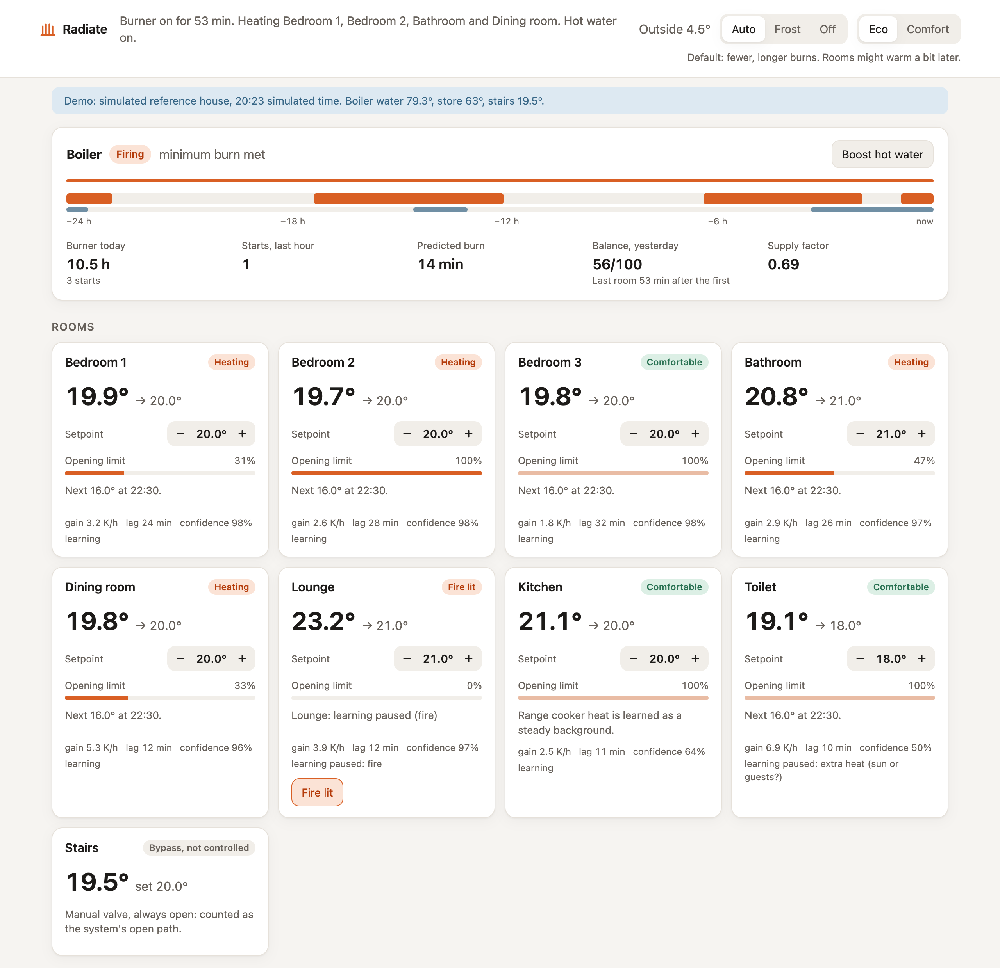

# Radiate

**Source-available, local-first hydronic balancing and boiler orchestration. Runs standalone or as a Home Assistant App. A cloud edition is planned.**

Plumbers balance a heating system by hand, turning the lockshield valve on each radiator to throttle the ones nearest the boiler so the far ones get their share of hot water. Radiate does that job in software, continuously, using smart radiator valves you already own.

> **Status:** pre-alpha. The control core, simulator, web UI, Home Assistant integration and App are tested against a simulated house. The Zigbee2MQTT and Shelly drivers, `radiate discover`, dry run, the Shelly watchdog installer, and the tick history with replay and bootstrap are in place but untested on real devices. Run real installs in dry run first; see [configuration](docs/configuration.md). [Implementation status](docs/implementation-status.md) lists what is built.

## Try it



Try the [online demo](https://jamesagarside.github.io/radiate/): a simulated 9-radiator house running the real engine in your browser. Nothing to install, and nothing leaves your browser.

To run the demo locally instead:

```bash
uv venv && uv pip install -e ".[dev]"
.venv/bin/radiate serve --demo --speed 60
```

Open http://localhost:8099 to watch a simulated 9-radiator house, 60 times faster than real time. Compare Radiate with plain smart TRVs:

```bash
.venv/bin/radiate sim --days 5
```

To run against real devices, describe your house in a YAML file, check it, and start the server. `radiate discover` drafts the file from the devices Zigbee2MQTT already knows, and only reads from the broker. You can also start from [`examples/reference-house.yaml`](examples/reference-house.yaml). The server runs in dry run until the file says otherwise:

```bash
.venv/bin/radiate discover --host 192.0.2.20 --username radiate --out radiate.yaml
.venv/bin/radiate check-config radiate.yaml
.venv/bin/radiate serve --config radiate.yaml
```

The server records every tick, so `radiate replay` shows what Radiate would have done during a dry run, and `radiate bootstrap` relearns the room models from that history. Before you turn dry run off, install the boiler watchdog with `radiate shelly install-watchdog`. See [replay and bootstrap](docs/deployment.md#replay-and-bootstrap) and [Shelly watchdog](docs/deployment.md#shelly-watchdog).

To run Radiate in Docker, on a Raspberry Pi, as a Home Assistant App or with the HACS integration, see [deployment](docs/deployment.md).

Tests: `.venv/bin/pytest` (core, config, drivers, simulator, server). The Home Assistant integration tests run in a separate environment; see [CONTRIBUTING.md](CONTRIBUTING.md).

## Why

Commercial systems now offer automatic ("digital") hydronic balancing, but it is locked behind proprietary hardware and, in some cases, a monthly subscription. The open-source Home Assistant ecosystem already does excellent per-room control (see [prior art](docs/research/prior-art.md)), but nothing yet coordinates radiators **across the whole house** so that flow is shared out fairly when every room calls for heat.

Radiate aims to close that gap without a subscription and without the internet.

## Goals

- **Whole-house balancing.** Learn how quickly each radiator heats up after the boiler fires, and limit how far over-supplied radiators open so under-supplied ones get flow.
- **Local first.** The control loop always runs in your home: on a Raspberry Pi, as a Home Assistant App, or on the cloud edition's local edge. No subscription needed to heat your house; the cloud adds remote access and history, never control features.
- **Whole-house, not per room.** One model of every room, radiator, the boiler and the hot-water store, optimised together, so rooms warm up together and the burner runs fewer, longer burns.
- **Other heat sources.** Pause learning for rooms heated by an open fire, range cooker, wood burner or sun, so they aren't mistaken for over-supplied radiators.
- **Boiler-aware.** Aggregate room demand into a single boiler call with minimum burn and minimum off times to prevent short-cycling (important for oil and older non-modulating boilers), and schedule a hot-water store separately.
- **Observable.** Expose learned parameters and decisions in the web UI and as Home Assistant entities, with optional export to Elastic for analysis.
- **Safe failure.** If Home Assistant or Radiate stops, valves and boiler fall back to sensible local behaviour.

## Editions

| Edition | For | UI |
|---|---|---|
| Standalone (Docker, Raspberry Pi) | No Home Assistant | Built-in web UI |
| Home Assistant App | Home Assistant OS | Same UI in the sidebar, plus entities via the HACS integration |
| Cloud (planned) | Remote access, history, several homes | Hosted UI; a small local edge still runs the control loop |

See [ADR-0002](docs/adr/0002-deployment-topology.md).

## Non-goals

- Modulating boiler flow temperature (OpenTherm etc.), at least initially.
- Certification under DIN 94679-4 or similar. Radiate is a community tool, not a certified balancing procedure.

## Reference hardware

The first target setup:

- Sonoff TRVZB radiator valves via Zigbee2MQTT (writable `valve_opening_degree`, external temperature input)
- Sonoff SNZB-02B room temperature and humidity sensors
- SMLIGHT SLZB-06U Ethernet Zigbee coordinator
- Shelly 2PM Gen4 two-channel relay switching an on/off oil combi boiler (heating demand plus hot-water store schedule)

Other TRVs that expose a writable valve position should follow.

## Documentation

The [documentation index](docs/README.md) lists everything. The main pages:

- [Deployment](docs/deployment.md)
- [Configuration](docs/configuration.md)
- [Specification](docs/spec.md)
- [Glossary](docs/GLOSSARY.md)
- [Engineering standards](docs/standards/engineering.md) and [design standards](docs/standards/design.md)
- [Contributing](CONTRIBUTING.md)
- [Prior art and gap analysis](docs/research/prior-art.md)
- [Simulation findings](docs/simulation.md)
- [Feature coverage matrix](docs/research/coverage-matrix.md)
- [ADR-0001: standalone, not a VTherm companion](docs/adr/0001-standalone-vs-vtherm-companion.md)
- [ADR-0002: one engine, three editions](docs/adr/0002-deployment-topology.md)
- Source analyses: [Versatile Thermostat](docs/research/vtherm.md), [Better Thermostat](docs/research/better-thermostat.md), [commercial products](docs/research/commercial.md), [provenance](docs/research/provenance.md)
- [Reverse-engineering and clean-room policy](docs/research/reverse-engineering-policy.md)

## Licence

[Elastic License 2.0](LICENSE) (ELv2). Free to use, modify and self-host. You may not offer Radiate as a hosted or managed service, or remove licensing notices. ELv2 is source-available rather than OSI-approved open source.
